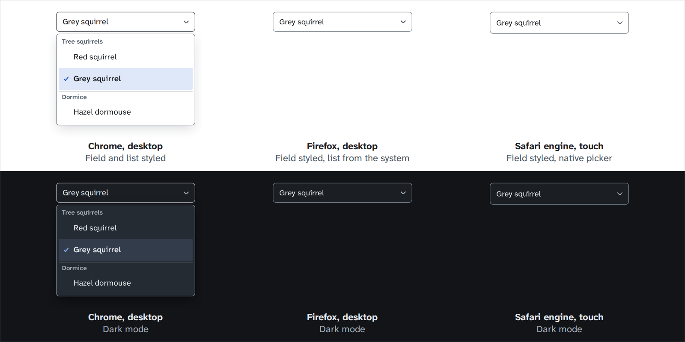

# SquirrelSelect

[](https://www.npmjs.com/package/@3m5-de/squirrel-select)
[](LICENSE)

> [!NOTE]
> Version 1.0 is in preparation. The package on npm today (0.1.x) is the old JavaScript dropdown; its documentation is in the tag [v0.1.5](https://github.com/3m5/squirrel-select/tree/v0.1.5). The CDN path `@1` and the documentation site work once 1.0 is released.
>
> To try the release candidate: `npm install @3m5-de/squirrel-select@next`, or from a CDN `https://cdn.jsdelivr.net/npm/@3m5-de/squirrel-select@1.0.0-rc.1/dist/squirrel-select.css`.

**Not a dropdown widget. A stylesheet for the native `<select>`.**

One class, no JavaScript. Keyboard, screen readers, autofill and form validation stay with the browser, because it is still the real `<select>`.



## Quickstart

```html
<link rel="stylesheet" href="https://cdn.jsdelivr.net/npm/@3m5-de/squirrel-select@1/dist/squirrel-select.css">

<label for="fruit">Fruit</label>
<select class="sqs" id="fruit" name="fruit">
  <option>Apple</option>
  <option>Pear</option>
</select>
```

Using npm? `npm install @3m5-de/squirrel-select`, then `import '@3m5-de/squirrel-select/squirrel-select.css'`.

Make it yours with CSS variables, on any parent element:

```css
.filters { --sqs-accent: light-dark(#b0185a, #ff8cc6); --sqs-radius: 999px; }
```

[Documentation](https://3m5.github.io/squirrel-select/docs/index.html) · [Quickstart](https://3m5.github.io/squirrel-select/docs/quickstart.html) · [All states](https://3m5.github.io/squirrel-select/examples/states.html) · [Playground](https://3m5.github.io/squirrel-select/playground.html)

## What it is not

- **Not pixel-identical everywhere.** Chrome, Edge and Safari 27+ on desktop get a fully styled list. In Firefox, and in Safari and Chrome without `base-select`, the closed select follows your design, but the open list comes from the browser or operating system. Browsers older than Chrome 123, Firefox 120 and Safari 17.5 get the browser's default select.
- **Not a custom picker on phones.** The closed select follows your design, but choosing an option opens the native iOS or Android picker. That is on purpose.
- **Not a component.** No init call, no wrapper, no React or Vue package. If your template can write `<select class="sqs">`, it works.
- **No search.** The core stays CSS only. An optional search module is planned for 1.1.

## How it works

| Where | Closed field | Open list |
|---|---|---|
| Chrome and Edge 135+, Safari 27+ on desktop, with mouse or trackpad | styled | styled |
| Firefox, Safari 17.5 to 26, Chrome and Edge 123 to 134 on desktop | styled | from the browser or system |
| Touch devices (phones, tablets without mouse or trackpad) | styled, at least 16 px text and 44 px high | native picker |
| Older browsers (Chrome < 123, Firefox < 120, Safari < 17.5) | browser default | browser default |

Lists with `multiple` or `size` greater than 1 are styled in every browser as well: box, rows and checked options. Choosing and focus stay the browser's own.

The goal is the same tokens, not the same pixels. Screenshots from our test runs and the reasons behind each path: [How it works](https://3m5.github.io/squirrel-select/docs/how-it-works.html).

## Install

From npm:

```sh
npm install @3m5-de/squirrel-select
```

```js
import '@3m5-de/squirrel-select/squirrel-select.css'
```

From a CDN, for production with a pinned version and an `integrity` hash:

```html
<link rel="stylesheet"
      href="https://cdn.jsdelivr.net/npm/@3m5-de/squirrel-select@1.0.0/dist/squirrel-select.css"
      integrity="sha384-…" crossorigin="anonymous">
```

Compute the hash from the pinned URL:

```sh
curl -s https://cdn.jsdelivr.net/npm/@3m5-de/squirrel-select@1.0.0/dist/squirrel-select.css | openssl dgst -sha384 -binary | openssl base64 -A
```

Or host `dist/squirrel-select.css` yourself. The file is minified and has a source map. There is one path per file and no JavaScript entry point.

## Customize

All styles live in the cascade layer `squirrel`, so your own CSS outside a layer always wins, without `!important`. The most used variables:

| Variable | Default (light / dark) | Used for |
|---|---|---|
| `--sqs-accent` | `#2754c5` / `#8fb1ff` | focus ring, checkmark, selection in lists |
| `--sqs-radius` | `.375rem` | corners |
| `--sqs-font-size` | `1rem` | text size and overall size |
| `--sqs-border` | `#7d8691` / `#77818c` | border |
| `--sqs-bg` | `#fff` / `#1b1f24` | field background |
| `--sqs-text` | `#1c2024` / `#e4e7eb` | text |

For dark mode, declare `color-scheme: light dark` on your page. All variables, and where each one takes effect: [Theming](https://3m5.github.io/squirrel-select/docs/theming.html).

## Recipes

[Plain HTML](https://3m5.github.io/squirrel-select/docs/recipes/html.html) · [React](https://3m5.github.io/squirrel-select/docs/recipes/react.html) · [Vue](https://3m5.github.io/squirrel-select/docs/recipes/vue.html) · [Svelte](https://3m5.github.io/squirrel-select/docs/recipes/svelte.html) · [Angular](https://3m5.github.io/squirrel-select/docs/recipes/angular.html) · [TYPO3 Fluid](https://3m5.github.io/squirrel-select/docs/recipes/typo3-fluid.html) · [Symfony and Twig](https://3m5.github.io/squirrel-select/docs/recipes/symfony-twig.html) · [Laravel Blade](https://3m5.github.io/squirrel-select/docs/recipes/laravel-blade.html)

Styles not applying, or using Tailwind CSS? See [Troubleshooting](https://3m5.github.io/squirrel-select/docs/troubleshooting.html).

## Accessibility

SquirrelSelect only changes how the select looks; the browser keeps doing the rest. Your part: a visible label for every select, visible text in every option, error messages as text, keep the focus ring, and enough contrast if you change colors. Results by browser and screen reader: [Accessibility](https://3m5.github.io/squirrel-select/accessibility.html) ([Deutsch](https://3m5.github.io/squirrel-select/de/barrierefreiheit.html)).

## Browser support and versioning

Every browser gets a working, native select. Each change is tested in current Chromium, WebKit and Firefox. By hand, before every minor release: a short checklist on a real Android device with TalkBack, and keyboard with zoom in Chrome, Edge and Firefox. iPhone is not tested on a real device; the automated tests run the Safari engine with touch emulation. Patch releases get a short smoke test. The public API is the class `sqs`, the classes `sqs-icon`, `sqs-hint` and `sqs-arrow-start`, the documented CSS variables, the layer name `squirrel` and the file path; changing any of them needs a major version. Details: [Browser support](https://3m5.github.io/squirrel-select/docs/browser-support.html).

## Migrating from 0.x

1.0 replaces the JavaScript dropdown with a stylesheet. Remove the old import and init call, rename `sqs-dropdown-select` to `sqs`, load the stylesheet, and delete your CSS for the old dropdown. Step by step: [Migrating from 0.x](https://3m5.github.io/squirrel-select/docs/migrating.html).

## Contributing

We gladly accept contributions. Please open an issue or send a pull request.

```sh
npm ci
npm run dev                  # local site with all states
npm test                     # lint, types, build, size budget, package check
npm run test:browser:docker  # browser tests in the Playwright container
```

## Security

Please report vulnerabilities privately, see [SECURITY.md](SECURITY.md).

## Authors & sponsor

- Maurice Kaltofen – [maurice.kaltofen@3m5.de](mailto:maurice.kaltofen@3m5.de)
- Tim Goßrau – [TimG1804](https://github.com/TimG1804)
- Robert Heinig – [robert-heinig](https://github.com/robert-heinig)

Development and public releases are generously sponsored by our employer, [3m5.](https://www.3m5.de)

## License

[MIT](LICENSE)
